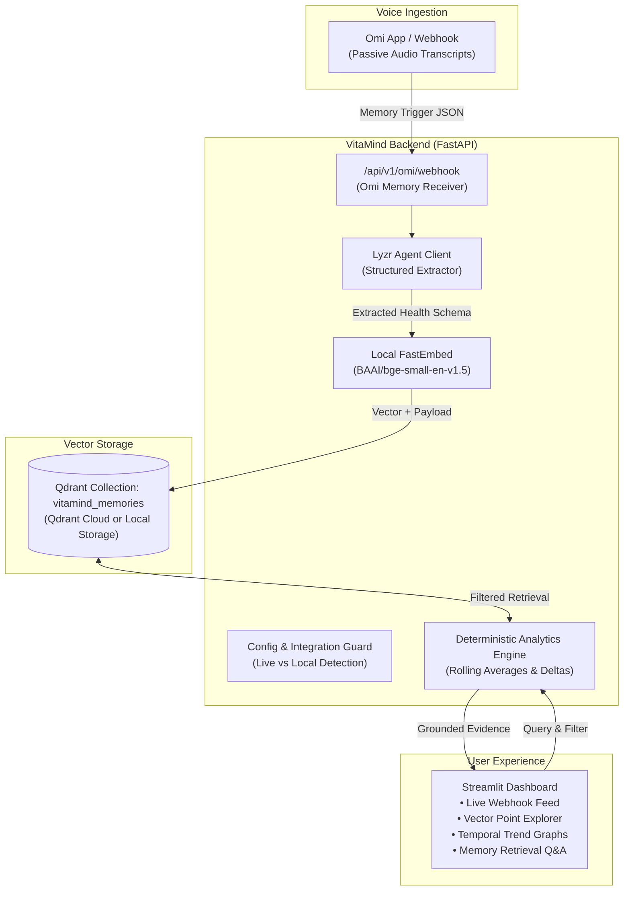

# VitaMind — Continuous Health & Habit Intelligence

> **Hackathon:** Lyzr × Qdrant × Omi Hackathon  
> **Track:** Continuous Health & Habit Tracking (*"Voice daily logs with temporal trend detection"*)  
> **Status:** Milestone 0 & 1 Complete (Greenfield Build)

---

## 1. Overview
VitaMind is a voice-first cognitive agent designed for continuous health and habit tracking. By ingesting passive ambient voice logs through **Omi**, extracting structured clinical-habit entities with **Lyzr**, and maintaining long-term episodic memory in **Qdrant Cloud**, VitaMind performs deterministic temporal trend detection and answers user queries backed by timestamped evidence.

---

## 2. Architecture Diagram



---

## 3. Quickstart & Installation (Windows)

### Prerequisites
* Python 3.12+ (or `uv` package manager)
* Git

### Step 1: Virtual Environment Setup
```powershell
cd vitamind
uv venv --python 3.12 .venv
.venv\Scripts\activate
uv pip install -r requirements.txt
```

### Step 2: Environment Configuration
Copy `.env.example` to `.env`:
```powershell
cp .env.example .env
```
*(If credentials are not yet available, VitaMind automatically defaults to safe Local Storage and Local Embeddings mode).*

### Step 3: Run the Test Suite
```powershell
pytest -v
```

### Step 4: Run the FastAPI Service
```powershell
uvicorn src.api.app:app --host 0.0.0.0 --port 8000 --reload
```

---

## 4. Integration Status Matrix

| Provider | Mode | Status | Verification Path |
| :--- | :--- | :--- | :--- |
| **Qdrant** | Local Disk / Cloud | Verified (Local & Cloud Ready) | `GET /api/v1/config/status`, Unit Test `test_qdrant_memory.py` |
| **Embeddings** | Local (`fastembed`) | Verified (Zero Cost, No API Key) | Unit Test `test_qdrant_memory.py` |
| **Lyzr** | REST API | Adapter Ready (Awaiting API Key) | Adapter module in `src/agents/lyzr_client.py` |
| **Omi** | Webhook Receiver | Schema Ready (Live & Simulated) | `POST /api/v1/omi/webhook`, Unit Test `test_schemas.py` |
